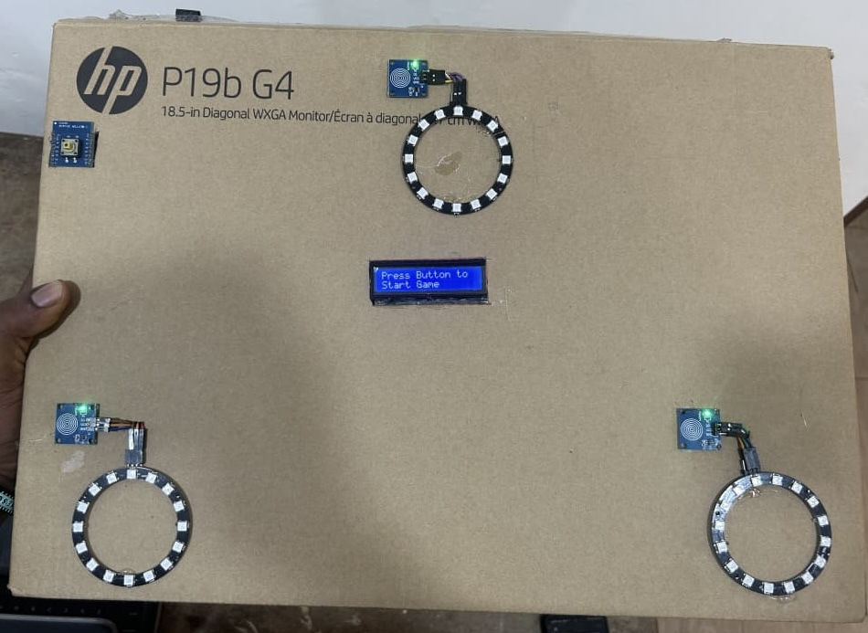

# ESP32 Reaction Game

## Overview
An interactive color reaction game designed and developed for a university exhibition during my final year of BSc Computer Science at the University of Cape Coast.

The game challenges players to identify and touch the correct color within a limited time using an ESP32-based interactive system.

## Project Prototype

## Gameplay Demonstration

[Watch the ESP32 Reaction Game demonstration](game-demonstration.MP4)

## Features
- Three RGB LED color indicators: Red, Green, and Blue.
- Randomized color selection.
- Capacitive touch input detection.
- LCD display for game instructions and feedback.
- Timed reaction challenges.
- Score tracking across 15 rounds.
- Buzzer feedback for correct and incorrect responses.
- Game completion sound.

## Hardware Components
- ESP32 microcontroller
- 3 NeoPixel LED rings (16 LEDs each)
- 3 touch sensors
- 16x2 I2C LCD display
- Push button
- Buzzer

## Technologies
- MicroPython
- Python
- Embedded Systems
- Hardware-Software Integration
- GPIO
- I2C
- PWM

## How to Play
1. Press the start button.
2. Wait for a color to appear.
3. Touch the sensor corresponding to the displayed color within one second.
4. Receive feedback on the LCD screen.
5. Complete all 15 rounds to see your final score.

## Hardware Pin Configuration

| Component | ESP32 GPIO |
|---|---|
| Red LED Ring | 5 |
| Green LED Ring | 18 |
| Blue LED Ring | 19 |
| Red Touch Sensor | 4 |
| Green Touch Sensor | 32 |
| Blue Touch Sensor | 33 |
| Buzzer | 25 |
| Start Button | 27 |
| LCD SDA | 21 |
| LCD SCL | 22 |

## Implementation
The game was programmed using MicroPython, with randomized color generation, timed input detection, score calculation, and hardware interaction.

## Project Status
An interactive color reaction game designed and developed for a university exhibition during my final year.
